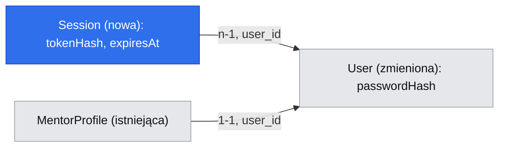

# Konto i logowanie e-mailem i hasłem

Issue: #19 (E06-S01, epik #18). Autorytet produktowy: `.ai/specs/product-brief.md` (D04, D05, D07).

## 📝 TLDR

Deweloper i mentor muszą mieć konto: deweloper, żeby wysłać pytanie (D04), a mentor, żeby założyć profil. Dziś aplikacja nie ma logowania: `readSession` w `packages/core/src/http/auth.ts` zawsze zwraca `null`, więc każda chroniona trasa odmawia.

Proponujemy:

- rejestrację i logowanie e-mailem i hasłem (D07), bez weryfikacji e-maila;
- sesje przechowywane w bazie, z losowym tokenem w cookie `devmentor_session`;
- wylogowanie, które unieważnia sesję;
- sprawdzanie nagłówka CSRF po stronie serwera.

Rolę administratora dodaje #20 (E06-S02), a reset hasła to osobna, późniejsza historia.

## 📝 Problem Statement

- D04 wymaga konta przed wysłaniem pytania. R06 i D06 wymagają administratora, który opiera się na tej samej sesji. Bez logowania nie da się zrealizować E01–E04 (D05).
- Kod jest przygotowany na logowanie:
  - `readSession` ma miejsce na weryfikację sesji;
  - `requireSession` i `assertOwnership` wyrażają reguły dostępu;
  - `apiCall` wysyła nagłówek CSRF `x-devmentor-request`, ale serwer go nie sprawdza (`BACKWARD_COMPATIBILITY.md` §7).
- Ryzyko A01 z briefu: każdy dodatkowy krok przy zakładaniu konta może zniechęcić dewelopera z pilnym problemem („jak booking trwa więcej niż pięć minut to robię rollback”, wywiad z 2026-09-01). Dlatego rejestracja ma jeden ekran, nie ma weryfikacji e-maila (Q2), a konto od razu jest zalogowane.

## 📝 Proposed Solution

Rozstrzygnięte pytania (mkz, 2026-10-19, rekomendacje agenta zaakceptowane):

- **Q1, reset hasła:** osobna historia później. Do tego czasu reset robi się ręcznie, poza aplikacją. Powód: reset wymaga dostawcy e-maili, którego jeszcze nie wybrano.
- **Q2, weryfikacja e-maila:** brak. Konto działa od razu, zgodnie z A01. Koszt: ktoś może założyć konto na cudzy adres.
- **Q3, role:** sesja niesie `userId`, a „jest mentorem” znaczy „ma profil” i sprawdza to serwis. Typ `Role` i funkcja `requireRole` są przestarzałe od tej specyfikacji (zob. Risks). Flagę `isAdmin` dodaje #20.
- **Q4, sesje:** przechowywane w bazie, bo dają się unieważnić. Logowanie odblokowuje pieniądze (E03), więc skradzioną sesję trzeba móc odciąć.

Odrzucone alternatywy:

- **Podpisane, bezstanowe cookie (JWT/HMAC):** wybór Q4.
- **Biblioteka do auth (Auth.js, Lucia):** dodaje zależność z własnym modelem danych i adapterem MikroORM. Tymczasem potrzebujemy tylko e-maila i hasła, a reguły dostępu już mamy w `auth.ts`.
- **`argon2` lub `bcrypt` jako zależność:** wbudowany w Node `crypto.scrypt` jest funkcją wolną i odporną na ataki pamięciowe. Nie dodaje natywnego skryptu instalacyjnego (`allowScripts`) ani wyjątku od `min-release-age`.

Na rynku Auth.js i Lucia trzymają sesję w bazie z tokenem w cookie `HttpOnly` i zapisują w bazie tylko hash tokenu. Przyjmujemy ten wzorzec. Pomijamy OAuth, magic linki i 2FA, bo D07 ich nie obejmuje.

## 📝 Architecture

- **`db`:**
  - nowe pole `passwordHash` w `User`;
  - nowa encja `Session` w `packages/db/src/entities/auth/session.entity.ts`;
  - migracja.
- **`core`:**
  - `AuthService` w `packages/core/src/services/auth/auth.service.ts`: `register`, `login`, `logout`, `resolveSession(token)`;
  - `password.ts` w tym samym folderze: `hashPassword` i `verifyPassword` na `crypto.scrypt` z `timingSafeEqual`;
  - schematy zod `registerSchema` i `loginSchema` w `packages/core/src/validators/auth/`;
  - `SESSION_TTL_DAYS` w `packages/core/src/config/env.ts`, domyślnie 30.
- **`core/http`:**
  - `readSession(req, cradle?)` zachowuje dotychczasową sygnaturę i dostaje opcjonalny `cradle`. Bez cookie albo z cookie o złej długości zwraca `null`, nie dotykając bazy, bo aplikacja musi się uruchamiać bez bazy. Z poprawnym cookie rozwiązuje token przez `authService` z przekazanego `cradle`. Jeśli wywołujący jest już w zakresie (jak `authorize` w `makeCrudRoute`, które działa w `withScope`), nie otwiera drugiego zakresu. Bez `cradle` otwiera `withScope`;
  - `readSessionFromCookieHeader(cookieHeader, cradle?)`: ten sam odczyt dla stron RSC, które nie mają obiektu `Request`. Aplikacja przekazuje `(await cookies()).toString()`, a `core` nie importuje `next/headers`;
  - `requireSession(req, cradle?)` najpierw wywołuje `requireCsrf(req)`, potem `readSession`.
- **Przygotowanie w osobnym, wcześniejszym PR** (Phase 1), żeby refaktor nie jechał w PR z `risk-high`:
  - eksportowany `parseBody(req, schema)`, wyciągnięty z prywatnych funkcji `makeCrudRoute.ts`;
  - eksportowany `requireCsrf(req)`: dla metod innych niż `GET`/`HEAD` brak nagłówka `x-devmentor-request` daje 403 (§7). Wywołują go `requireSession` i trzy trasy auth, które nie mają sesji i nie przechodzą przez `requireSession`.

  Specyfikacja profilu mentora używa obu i zależy od tego PR.

- **`app`:**
  - trasy `packages/app/src/app/api/auth/register/route.ts`, `.../login/route.ts` i `.../logout/route.ts`, wszystkie na `apiHandler` + `parseBody`;
  - strony `/login` i `/register`.
- **Bez drugiej ścieżki tworzenia użytkownika:** `AuthService.register` woła istniejące `UserService.create` (które już zapisuje użytkownika i emituje `auth.user.created` z niezmienionym payloadem `{ userId, email }`, §6). `UserService` dostaje wewnętrzną metodę `createWithPassword`, a obie metody współdzielą tę samą ścieżkę zapisu i zdarzenia. `toUserDto` wypisuje pola jawnie, więc `passwordHash` nie wycieknie przez publiczne `GET /api/users`. Pilnuje tego test regresyjny.

## 📝 Data Model

**`User`** (`users`), zmiana addytywna:

| Pole (kolumna)                   | Typ                | Uwagi                                                                                                                                                                                                                           |
| -------------------------------- | ------------------ | ------------------------------------------------------------------------------------------------------------------------------------------------------------------------------------------------------------------------------- |
| `passwordHash` (`password_hash`) | `string`, nullable | Format `scrypt$N$r$p$salt$hash` (base64). Nullable, bo istniejący użytkownik z seedera i użytkownicy z `POST /api/users` nie mają hasła; logowanie na takie konto kończy się ogólnym błędem. Nigdy nie trafia do DTO ani logów. |

**`Session`** (`sessions`), nowa encja:

| Pole (kolumna)             | Typ                                        | Uwagi                                                                                       |
| -------------------------- | ------------------------------------------ | ------------------------------------------------------------------------------------------- |
| `id` i znaczniki czasu     | z `baseProperties`                         |                                                                                             |
| `user` (`user_id`)         | FK do `users`, `on delete cascade`, indeks |                                                                                             |
| `tokenHash` (`token_hash`) | `string`, unikalny                         | SHA-256 tokenu. Sam token (32 losowe bajty, base64url) istnieje tylko w cookie.             |
| `expiresAt` (`expires_at`) | `timestamptz`                              | `createdAt + SESSION_TTL_DAYS`. Okno ważności jest stałe, nie przesuwa się przy aktywności. |

- E-mail normalizujemy: `trim` i małe litery. Istniejący unikalny indeks na `users.email` zostaje.
- `displayName` (wymagane w `User`) dostaje przy rejestracji wartość lokalnej części e-maila, a użytkownik może go zmienić później. Dzięki temu rejestracja ma tylko dwa pola.
- Wygasłe sesje nie są usuwane w tle, bo projekt nie ma kolejki. Wygasła sesja jest ignorowana przy odczycie, a `login` usuwa wygasłe sesje tego użytkownika.
- Nowa migracja aktualizuje istniejący snapshot `.snapshot-devmentor.json`. `down` usuwa tabelę `sessions` i kolumnę `password_hash`.

Model jest mały, więc widok HTML pominąłem.

## 📝 API Contracts

Wszystkie trasy zwracają kopertę `{ ok, data }` / `{ ok, error }` i jako pierwsze wywołują `requireCsrf`, czyli wymagają nagłówka `x-devmentor-request`. Dotyczy to także logowania, co chroni przed login CSRF.

| Trasa                     | Wejście                                                       | Sukces                                                     | Błędy                                                                                                     |
| ------------------------- | ------------------------------------------------------------- | ---------------------------------------------------------- | --------------------------------------------------------------------------------------------------------- |
| `POST /api/auth/register` | `{ email: string (email, ≤ 254), password: string (12–128) }` | `201 { ok: true, data: { userId, email } }` i `Set-Cookie` | `422` (walidacja), `409 email_taken`, `403` (brak nagłówka CSRF)                                          |
| `POST /api/auth/login`    | `{ email, password }`                                         | `200 { ok: true, data: { userId, email } }` i `Set-Cookie` | `401 invalid_credentials`, jeden komunikat dla złego e-maila, złego hasła i konta bez hasła; `422`, `403` |
| `POST /api/auth/logout`   | brak                                                          | `200`, usunięcie wiersza sesji i cookie z `Max-Age=0`      | idempotentne; bez sesji też `200`                                                                         |

- **Cookie `devmentor_session`:**
  - `HttpOnly`, `SameSite=Lax`, `Path=/`;
  - `Secure` przy `NODE_ENV=production`, odczytanym przez `getEnv()`, a nie `process.env`;
  - `Max-Age` równe TTL.
- **Wyciek informacji przy rejestracji:** `409 email_taken` ujawnia, że konto istnieje. To świadomy kompromis na rzecz prostej rejestracji. Przy logowaniu nic nie wycieka.
- **Czas odpowiedzi logowania:** `login` liczy scrypt na stałym, fałszywym hashu zarówno dla nieistniejącego e-maila, jak i dla konta z `passwordHash = null`. Czas odpowiedzi nie zdradza więc, czy konto istnieje i czy ma hasło.
- **Fiksacja sesji:** `login` i `register` usuwają sesję wskazaną przez przychodzące cookie, jeśli taka jest, i zawsze wydają nowy token.
- **Kontrakty publiczne:**
  - trzy nowe trasy dopisujemy do `BACKWARD_COMPATIBILITY.md` §2;
  - zmiana `Session` i przestarzałość `Role`/`requireRole` trafia do §2 i §7;
  - `GET`/`POST /api/users` zostają publiczne; zabezpiecza je #20.

## 📝 UI/UX

Strony publiczne, Tailwind, teksty po polsku:

- **`/register`:** dwa pola (e-mail, hasło) i przycisk „Załóż konto”. Pod hasłem stała podpowiedź „co najmniej 12 znaków”.
- **`/login`:** e-mail, hasło, „Zaloguj się” i link do rejestracji. Brak linku „nie pamiętam hasła”, bo reset jest osobną historią.
- **Powrót po zalogowaniu:** obie strony przyjmują parametr `next`, a po sukcesie przekierowują pod ten adres. Wartość musi być ścieżką względną zaczynającą się od `/`, a nie `//`, inaczej przekierowanie trafia na `/` (ochrona przed open redirect). Formularz pytania (E02-S01) przechowuje szkic w `sessionStorage` i odtwarza go po powrocie (D04).
- **Wylogowanie:** przycisk w nawigacji dla zalogowanych.
- **Stany:**
  - wysyłanie: przycisk zablokowany z napisem „Trwa…”;
  - błędy przy polach z `fieldErrors`;
  - błąd ogólny: „Nieprawidłowy e-mail lub hasło”.
- **Dostępność:** etykiety przy polach, `autocomplete="email"`, `new-password` / `current-password`, błędy powiązane przez `aria-describedby`. Strona musi przejść `seriousA11yViolations() = []`.

## 📝 Edge Cases & Failure Scenarios

- **Dwie równoległe rejestracje na ten sam e-mail:** unikalny indeks rozstrzyga. Druga dostaje `409`, a serwis mapuje naruszenie unikalności na `ConflictError`.
- **Logowanie na konto bez hasła** (z seedera lub z `POST /api/users`): `401 invalid_credentials`.
- **Wygasła albo usunięta sesja:** `readSession` zwraca `null`, więc trasa daje `401`. Strona RSC sprawdza sesję przez `readSessionFromCookieHeader` i przekierowuje do `/login?next=…`.
- **Podrobione albo losowe cookie:** cookie o złej długości jest odrzucane przed zapytaniem do bazy. Poprawnie sformatowany, ale nieznany token nie ma hasha w bazie. W obu przypadkach wynik jest jak bez sesji.
- **Brak nagłówka CSRF przy `POST`:** `403 forbidden`. Formularz z innej domeny nie może ustawić tego nagłówka.
- **Baza niedostępna przy odczycie sesji:** `readSession` przepuszcza błąd. `apiHandler` loguje go i zwraca `500`, a nie `401`, żeby awaria nie udawała wylogowania. Strony publiczne działają bez bazy.
- **Hasło 1000 znaków:** `422` przed hashowaniem. Limit 128 chroni przed kosztownym scrypt na ogromnym wejściu.
- **Zgadywanie haseł:** projekt nie ma infrastruktury do limitowania liczby prób (brak Redisa i kolejki). Koszt scrypt spowalnia atak, ale go nie blokuje. To znane ryzyko, opisane w Risks.

## 📝 Risks & Impact Review

- **Logowanie, sesje i schemat bazy: `risk-high`** (`SDLC.md`).
  - Wymagane: `needs-qa`, druga osoba w review i brak samodzielnego QA.
  - Migracja ma `up` i `down` sprawdzone w obu kierunkach.
  - Plan wycofania: `migration:down`, a `readSession` wraca do stanu „zawsze odmawia”.
- **Przestarzałość `Role` i `requireRole`:** to eksporty chronione w `BACKWARD_COMPATIBILITY.md` §2 i §7.
  - Zostają eksportowane i oznaczone `@deprecated`. `Session` traci pole `role`, więc `requireRole` zawsze zwraca 403, co jest bezpiecznym zachowaniem.
  - W repo nie ma żadnego wywołania `requireRole` poza samym eksportem.
  - Usunięcie w osobnym PR po #20, który wprowadza `requireAdmin`.
  - Typ `Session` traci `role`, a to zmiana kształtu eksportu. Jest dopuszczalna teraz, bo §7 uznaje `Role` za łamiący dopiero „once auth ships”. Trzeba ją opisać w PR.
- **Brak limitu prób logowania.** Wymaga decyzji o infrastrukturze, więc proponuję follow-up issue przed pierwszą prawdziwą płatnością (Q03 z briefu dotyczy tego samego momentu).
- **Konto na cudzy adres** to konsekwencja Q2. Reset hasła (Q1) będzie musiał to uwzględnić.
- **Rejestracja ujawnia istnienie konta** (`409`). To świadomy kompromis, opisany w API Contracts.

## 📝 Decisions in play

- **D04:** konto przed wysłaniem pytania. Właściciel: mkz.
- **D05:** logowanie jest pierwszym punktem Now. Właściciel: mkz.
- **D07:** e-mail i hasło. Właściciel: mkz.
- **A01:** wymóg konta jest ryzykiem dla szybkości rezerwacji. Dlatego rejestracja ma dwa pola i nie ma weryfikacji.

Specyfikacja nie zastępuje żadnego wpisu z briefu.

## 📋 Phasing

- **Phase 1: przygotowanie, osobny PR.** `parseBody` i `requireCsrf` w `core/http`. Zachowanie bez zmian, bo nic jeszcze z nich nie korzysta poza fabryką. `risk-medium`.
- **Phase 2: model i hasła.** Kolumna `password_hash`, encja `Session`, migracja i `password.ts`. Aplikacja działa bez zmian widocznych dla użytkownika.
- **Phase 3: API logowania.** `AuthService`, trasy, prawdziwe `readSession`/`readSessionFromCookieHeader`. Chronione trasy zaczynają działać z sesją.
- **Phase 4: strony.** `/register`, `/login`, wylogowanie w nawigacji i test integracyjny.

Każdy krok dodaje swoje nowe pliki produkcyjne do `coverage.include` w `vitest.config.mts` w tej samej zmianie (AGENTS.md).

## 📋 Implementation Plan

### Phase 1: przygotowanie (osobny PR)

1. Wyciągnąć z `makeCrudRoute.ts` eksportowany `parseBody(req, schema)`. Komunikaty błędów chronione przez §2 muszą zostać identyczne, a istniejące testy fabryki przejść bez zmian.
2. Dodać eksportowany `requireCsrf(req)` i testy: `POST` bez nagłówka daje 403, `POST` z nagłówkiem przechodzi, `GET`/`HEAD` bez nagłówka przechodzą. Dopisać oba eksporty do `BACKWARD_COMPATIBILITY.md` §2.

### Phase 2: model i hasła

3. Dodać do `User` pole `passwordHash` (nullable). Utworzyć encję `Session` i zarejestrować ją w tablicy `entities`. Napisać testy encji.
4. Wygenerować migrację `auth-sessions` i zaktualizować snapshot. Dodać test integracyjny `up` i `down`.
5. Napisać `password.ts` (`hashPassword`, `verifyPassword`, scrypt, `timingSafeEqual`, parametry zakodowane w hashu). Testy jednostkowe: poprawne hasło, złe hasło, uszkodzony format, różne sole.

### Phase 3: API logowania

6. Dodać `registerSchema`, `loginSchema` i `SESSION_TTL_DAYS` w `env.ts`, dopisać zmienną do `.env.example`. Testy walidacji.
7. Dodać `UserService.createWithPassword`, współdzielącą zapis i zdarzenie z `create`. Napisać test regresyjny, że `GET /api/users` nie zwraca `passwordHash`.
8. Napisać `AuthService`: `register` (przez `createWithPassword`), `login` (fałszywy hash dla nieistniejącego e-maila i konta bez hasła, unieważnienie sesji z przychodzącego cookie, sprzątanie wygasłych), `logout`, `resolveSession`. Zarejestrować go jako `.scoped()`. Testy jednostkowe każdej gałęzi na fake'owym `em`.
9. Podpiąć `readSession(req, cradle?)` i `readSessionFromCookieHeader` pod `AuthService`, z wczesnym `null` bez bazy dla braku cookie lub złej długości. `requireSession` ma wołać `requireCsrf`. Oznaczyć `Role`/`requireRole` jako `@deprecated` i zmienić `Session` na `{ userId }`. Testy: brak cookie (bez zapytania do bazy), zła długość, nieznany token, wygasła sesja, poprawna sesja, ponowne użycie przekazanego `cradle`.
10. Dodać trasy `register`, `login` i `logout` na `apiHandler` + `requireCsrf` + `parseBody`, z ustawianiem i czyszczeniem cookie. Testy tras: `201`/`200`/`401`/`409`/`422`/`403`, atrybuty cookie, wymiana sesji przy logowaniu, `logout` bez sesji daje `200`.
11. Zaktualizować `BACKWARD_COMPATIBILITY.md` (§2, §7).

### Phase 4: strony

12. Dodać strony `/register` i `/login` z obsługą `next` (ochrona przed open redirect) oraz przycisk wylogowania w nawigacji. Pomocnik w `app` odczytuje sesję przez `readSessionFromCookieHeader((await cookies()).toString())`. Testy jednostkowe stanów i walidacji `next`.
13. Napisać test integracyjny (agent-browser): rejestracja, wejście na chronioną stronę, wylogowanie i ponowna odmowa (401), błędne logowanie z ogólnym komunikatem. Do tego `seriousA11yViolations() = []` na obu stronach. Harness udostępnia pomocnika „zaloguj użytkownika testowego” dla kolejnych historii (#10, #12).
