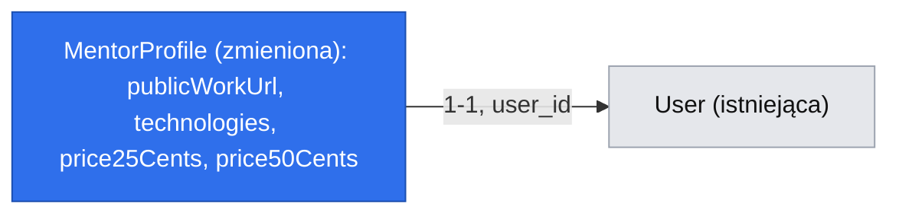

# Profil mentora z dorobkiem, technologiami i ceną

Issue: #10 (E01-S01, epik #5). Autorytet produktowy: `.ai/specs/product-brief.md`.

## 📝 TLDR

Mentor, czyli senior, który dziś odpowiada za darmo na powtarzające się pytania, nie ma w DevMentorze miejsca, żeby pokazać, co robił i ile kosztuje jego czas. Encja `MentorProfile` ma tylko pola zastępcze (`headline`, `bio`, `yearsOfExperience`). Proponujemy, żeby każdy zalogowany użytkownik mógł sam założyć i edytować swój profil mentora, który trafia do katalogu dopiero po ręcznej akceptacji (R06). Profil zawiera link do publicznej pracy, opis dorobku, technologie ze stałej listy i ceny w EUR za 25 i 50 minut. Nie ma w nim ocen (N02) ani danych do wypłat (R05). To podstawa katalogu (E01-S02, D02). Specyfikacja zależy od osobnej specyfikacji logowania, która jeszcze nie istnieje.

## 📝 Problem Statement

- Deweloper ocenia mentora po tym, co ten faktycznie zrobił, a nie po ocenach („nie senior engineer tylko robiłem upgrade ingress-nginx na 1.28”, wywiad z 2026-09-01 `[INTERVIEW]`). Ocen nie ma decyzją N02.
- Mentor nie poda danych do wypłat, zanim ktoś go zarezerwuje. Akceptuje najwyżej 20 minut konfiguracji (wywiad z 2026-09-03 `[INTERVIEW]`, reguła R05).
- Katalog (E01-S02) potrzebuje porównywalnych danych: technologii, do filtrowania, i ceny, widocznej przed napisaniem pytania (R02).
- Dziś `MentorProfile` ma pola zastępcze, a logowania nie ma. `readSession` w `packages/core/src/http/auth.ts` zawsze zwraca `null`.

## 📝 Proposed Solution

Rozszerzamy istniejącą encję `MentorProfile` addytywnie, czyli tylko nowymi kolumnami. Dokładamy własną trasę „mój profil” (`/api/mentors/me`) i stronę panelu mentora z formularzem `CrudForm`. Zalogowany użytkownik zakłada profil za pierwszym zapisem i edytuje go kolejnymi.

Odrzucone alternatywy:
- **Nowa encja zamiast rozszerzenia.** Dublowałaby relację 1:1 z `User`, którą już mamy.
- **`makeCrudRoute` dla `/api/mentors`.** Fabryka wymaga `list()` oraz zasobu adresowanego przez `id`, a „mój profil” jest pojedynczym zasobem właściciela sesji. Wystawienie `list()` otworzyłoby katalog bez zakresu E01-S02. Dlatego trasa używa `apiHandler` bezpośrednio, bez gołego `try/catch`, z błędami `AppError`. Parsowanie ciała i walidacja zod (`readJsonBody`, `parseWith`, `flattenZodError`) są dziś prywatne w `makeCrudRoute.ts`. Wyciągamy je do eksportowanego helpera `parseBody(req, schema)` w `packages/core/src/http`, używanego przez fabrykę i nową trasę, zamiast pisać walidację drugi raz.
- **Rola „mentor” nadawana przy rejestracji.** Q2 przesądza, że profil może założyć każdy zalogowany użytkownik (do katalogu trafia po akceptacji). Dlatego trasa wymaga tylko sesji (`requireSession`), a nie roli (`requireRole`).

Rozstrzygnięte pytania (mkz, 2026-10-19):
- **Q1:** logowanie dostaje osobną specyfikację i historię, zrobione przed #10.
- **Q2:** wariant (c) — profil może założyć każdy zalogowany użytkownik, ale w katalogu pojawia się dopiero po ręcznej akceptacji przez mkz (R06). Zmienione z (a) podczas przepytywania 2026-10-19: bez ocen i bez weryfikacji publiczny katalog odstraszał mentorów z wywiadów 2026-09-03.
- **Q3:** jedna waluta dla całej platformy, EUR.
- **Q4:** technologie ze stałej listy.

## 📝 Architecture

- **`db`:** nowe kolumny w `MentorProfile` i migracja w `packages/db/migrations/`.
- **`core`:**
  - `MentorProfileService` w `packages/core/src/services/mentors/`;
  - schemat zod `mentorProfileUpsertSchema` i stała `TECHNOLOGIES` w `packages/core/src/validators/mentors/`;
  - rejestracja serwisu w kontenerze (`.scoped()`).
- **`app`:**
  - trasa `packages/app/src/app/api/mentors/me/route.ts` (`GET`, `PUT`) na `apiHandler` + `requireSession`;
  - strona panelu mentora `packages/app/src/app/mentor/profile/page.tsx` z `CrudForm` i komunikatami z `feedback/`.
- **`ui`:** rozszerzenie `CrudForm` (`packages/ui/src/backend/forms/CrudForm.tsx`), który dziś obsługuje tylko pojedynczy checkbox (boolean):
  - nowy typ pola `checkbox-group`, renderowany jako `fieldset` + `legend`;
  - transformacja wartości per pole (`fromValue`/`toPayload`), potrzebna do zamiany euro ↔ eurocenty.

  Bez osobnych, ręcznie pisanych komponentów formularza.
- **`app`, nowa grupa tras:** folder `mentor/` jeszcze nie istnieje. To nowy panel persony, który stosuje zasady panelu `/admin`: komponenty shadcn z `@devmentor/ui`, nie sam Tailwind.
- **Zależność od przyszłej pracy:** specyfikacja logowania musi dostarczyć działające `readSession`, zwracające `userId`. Do tego czasu trasa odmawia każdemu (401), zgodnie z obecnym fail-closed.
- **Brak nowego zdarzenia.** Zdarzenie `mentors.profile.updated` bez konsumenta byłoby nowym chronionym kontraktem (`BACKWARD_COMPATIBILITY.md` §6), którego nic nie używa. Odkładamy je do E01-S02, jeśli katalog go będzie potrzebował.

## 📝 Data Model

Zmiana w `MentorProfile` (`mentor_profiles`). Wszystkie nowe kolumny są dopuszczające `NULL` albo mają wartość domyślną, bo istniejące wiersze, w tym rekord z seedera `Ada Lovelace`, ich nie mają (`BACKWARD_COMPATIBILITY.md` §3).

| Pole (kolumna) | Typ | Uwagi |
|---|---|---|
| `publicWorkUrl` (`public_work_url`) | `string`, nullable | Wymagane przy zapisie przez API (walidacja zod, tylko `https://`). Nullable w bazie ze względu na istniejące wiersze. |
| `bio` (istniejące) | `text`, nullable | Używane jako „opis dorobku”, bez zmiany nazwy kolumny. |
| `technologies` (`technologies`) | `text[]`, default `{}` | Wartości tylko ze stałej listy `TECHNOLOGIES`: `typescript`, `react`, `python`, `ai-agents`, `node`, `other`. Lista żyje w kodzie, a nie w bazie, więc rozszerzenie nie wymaga migracji. |
| `price25Cents` (`price_25_cents`) | `integer`, nullable | Cena w eurocentach. Wymagana przy zapisie przez API. |
| `price50Cents` (`price_50_cents`) | `integer`, nullable | Jak wyżej. |
| `approvedAt` (`approved_at`) | `timestamptz`, nullable | `NULL` = profil czeka na akceptację i nie jest widoczny w katalogu (R06). Ustawiane wyłącznie przez akceptację, nigdy przez `PUT /api/mentors/me`. |

- `headline` i `yearsOfExperience` zostają bez zmian. `headline` jest częścią `UserDto` i asercji testu integracyjnego, więc jego usunięcie byłoby zmianą łamiącą.
- Waluta nie jest kolumną, bo EUR jest stałą platformy (Q3). Kwoty trzymamy w liczbach całkowitych eurocentów, nigdy we float.
- Brak danych wrażliwych. Danych do wypłat celowo tu nie ma (R05, E03-S03).
- Nowa migracja powstaje przez `npm run db:migration:create -- --name mentor-profile-fields`. Dołącza do istniejącej `packages/db/migrations/Migration20260901142829.ts` i aktualizuje istniejący snapshot `.snapshot-devmentor.json`. `down` usuwa tylko dodane kolumny.



Mapa danych sprowadza się do jednej zmienionej encji i jej istniejącej relacji 1:1. Interaktywny widok HTML byłby trywialny, więc go pominąłem.

## 📝 API Contracts

`GET /api/mentors/me`, wymaga sesji:
- `200 { ok: true, data: MentorProfileDto }`, gdy profil istnieje;
- `404`, gdy profilu nie ma;
- `401` bez sesji.

`PUT /api/mentors/me`, wymaga sesji. Tworzy profil albo aktualizuje profil należący do `session.userId`.

```ts
// mentorProfileUpsertSchema (zod)
{
  headline: string (1–120),
  publicWorkUrl: string (url, https:, ≤ 500),
  bio: string (1–5000),
  technologies: Technology[] (min 1, unikalne, z TECHNOLOGIES),
  price25Cents: int (100–1_000_000),
  price50Cents: int (100–1_000_000),
}
// MentorProfileDto
{ id, headline, publicWorkUrl, bio, technologies, price25Cents, price50Cents, currency: 'EUR', status: 'pending' | 'approved', updatedAt }
```

- Odpowiedzi:
  - `200` z `MentorProfileDto` przy sukcesie;
  - `422` z `fieldErrors` przy błędzie walidacji;
  - `401` bez sesji.
- Właściciela wyznacza wyłącznie sesja. Ciało żądania nie przyjmuje `userId` ani `id`, więc nie da się edytować cudzego profilu.
- Brak `DELETE` w tym zakresie.
- Widełki cen (1 EUR – 10 000 EUR) to techniczna osłona przed pomyłką, a nie decyzja cenowa. Brief nie ustala progów cen, a mentorka ze staff level chce cen „wysoko”.
- **Kontrakty publiczne:** `/api/users` i `UserDto` zostają bez zmian. Nowa trasa jest addytywna i trzeba ją dopisać do `BACKWARD_COMPATIBILITY.md` §2 w tym samym PR.

## 📝 UI/UX

`/mentor/profile`, panel mentora z komponentami shadcn z `@devmentor/ui`, teksty po polsku:

- **Formularz:** jeden `CrudForm` z polami:
  - nagłówek;
  - link do publicznej pracy (z podpowiedzią „repozytorium, post, talk — coś, co pokazuje, że to robiłeś”);
  - opis dorobku;
  - technologie jako checkboxy;
  - ceny w EUR za 25 i 50 minut, wpisywane w euro i zamieniane na centy w formularzu.
- **Na stronie nie ma:**
  - pola na dane do wypłat (R05);
  - ocen (N02);
  - wideo (N01).
- **Stany:**
  - ładowanie przez `LoadingMessage`;
  - brak profilu: pusty formularz z napisem „Załóż profil mentora”;
  - błąd zapisu przez `ErrorMessage` i błędy przy polach;
  - sukces: komunikat „Profil zapisany”.
- **Dostępność:** etykiety przy wszystkich polach, grupa checkboxów w `fieldset` z `legend`. Strona musi przejść `seriousA11yViolations() = []`.
- **Czas:** całość mieści się w jednym ekranie, zgodnie z limitem 20 minut konfiguracji z wywiadu.

## 📝 Edge Cases & Failure Scenarios

- **Brak sesji:** trasa odpowiada `401`, a strona przekierowuje do logowania, które dostarcza specyfikacja logowania.
- **Mentor bez linku do pracy:** `422` z błędem przy `publicWorkUrl` (N02).
- **Link `http://` albo `javascript:`:** odrzucony, bo schemat dopuszcza tylko `https:`. To chroni przed XSS w katalogu.
- **Technologia spoza listy albo pusta lista:** `422`.
- **Cena 0, ujemna albo ułamkowa:** `422`.
- **Cena za 50 minut niższa niż za 25:** dopuszczalna. Mentor ustala cenę sam, a reguły w briefie brak.
- **Dwa równoległe `PUT` przy zakładaniu:** zapis to atomowe `INSERT … ON CONFLICT (user_id) DO UPDATE` (`em.upsert`), a nie łapanie błędu po nieudanym `flush`. Po takim błędzie `EntityManager` wciąż trzyma nieudany `INSERT`. Zapis jest idempotentny.
- **Istniejący profil z seedera bez nowych pól:** `GET` zwraca `publicWorkUrl: null`, `price25Cents: null`, `price50Cents: null`, `technologies: []`, a `bio` zgodnie ze stanem wiersza. Formularz prosi o uzupełnienie brakujących pól. Katalog (E01-S02) pokazuje tylko profile z kompletem pól.
- **Baza niedostępna:** `apiHandler` loguje błąd i zwraca `500` w kopercie API. Strona pokazuje `ErrorMessage`, a reszta aplikacji działa (trasa jest dynamiczna).

## 📝 Risks & Impact Review

- **Schemat bazy:** `risk-high` (`SDLC.md`, `BACKWARD_COMPATIBILITY.md` §3).
  - Zmiana jest wyłącznie addytywna.
  - Migracja ma `up` i `down`, a oba kierunki trzeba sprawdzić.
  - Seeder i asercje testu `admin.integration.test.ts` się nie zmieniają.
  - Plan wycofania: `migration:down` usuwa cztery kolumny i nie dotyka danych sprzed zmiany.
- **Zależność od logowania (Q1):** implementacja tej specyfikacji jest zablokowana, dopóki nie zostanie wdrożona specyfikacja logowania. Phase 1 da się wdrożyć wcześniej, ale Phases 2–3 i test integracyjny wymagają sesji. Specyfikacja logowania musi też rozstrzygnąć, czy rola w `Session` (`student | mentor`) wynika z istnienia profilu. Ta trasa celowo nie sprawdza roli.
- **Lista technologii w kodzie:** zmiana listy to zmiana kodu, a nie danych. Usunięcie wartości używanej przez istniejące profile byłoby zmianą łamiącą. Wartości wolno tylko dodawać.
- **Kierunek produktu a defekt:** to, że profil może założyć każdy (Q2), a nie tylko zaproszeni, jest decyzją produktową mkz, a nie naruszeniem reguły repozytorium.

## 📝 Decisions in play

- **N02:** bez ocen, w zamian link do publicznej pracy. Właściciel: founder A.
- **R02:** cena widoczna, zanim deweloper napisze pytanie. Profil przechowuje cenę. Właściciel: mkz.
- **R05:** brak danych do wypłat przed pierwszą rezerwacją. Właściciel: mkz.
- **D01:** sesje 25 lub 50 minut, stąd dwie ceny. Właściciel: founder A.
- **D02:** publiczny katalog, a ten profil jest jego źródłem. Właściciel: mkz.
- **R06:** profil mentora trafia do katalogu dopiero po ręcznej akceptacji. Właściciel: mkz (`.ai/specs/research/decisions/R06-mentor-approval.md`).

Specyfikacja nie zastępuje żadnego wpisu z briefu.

## 📋 Phasing

- **Phase 1: model danych.** Nowe kolumny i migracja. Aplikacja działa bez zmian widocznych dla użytkownika.
- **Phase 2: API „mój profil”.** Serwis, walidacja i trasa. Zaczynamy po wdrożeniu logowania.
- **Phase 3: panel mentora.** Rozszerzenie `CrudForm`, strona z formularzem i test integracyjny. Również po wdrożeniu logowania.

## 📋 Implementation Plan

### Phase 1: model danych

1. W `mentor-profile.entity.ts` dodać `publicWorkUrl` (nullable), `technologies` (`text[]`, default `{}`), `price25Cents` i `price50Cents` (nullable integer). Zaktualizować testy encji.
2. Wygenerować migrację `mentor-profile-fields` i snapshot. Sprawdzić `up` i `down` lokalnie, a w `tests/integration` dodać test migracji w obu kierunkach.

### Phase 2: API „mój profil”

3. W `packages/core/src/validators/mentors/` dodać `TECHNOLOGIES` i `mentorProfileUpsertSchema`. Napisać testy jednostkowe każdej reguły walidacji, w tym `https:`, widełek, pustej listy i duplikatów.
4. Napisać `MentorProfileService` z metodami `getForUser(userId)` i `upsertForUser(userId, input)`. Serwis zwraca `MentorProfileDto` i zapisuje przez atomowe `em.upsert` po `user_id`. Testy jednostkowe na fake'owym `em` oraz test integracyjny równoległego zakładania profilu.
5. Zarejestrować serwis w kontenerze (`.scoped()`) i rozszerzyć typ `Cradle`.
6. Użyć `parseBody(req, schema)` z `packages/core/src/http`, dostarczonego przez Phase 1 specyfikacji logowania (`.ai/specs/2026-10-19-email-password-login.md`). Dodać trasę `api/mentors/me/route.ts` (`GET`, `PUT`) z `apiHandler`, `requireSession` i `parseBody`. Testy jednostkowe tras: `401`, `404`, `422`, `200`, brak możliwości podania `userId` w ciele.
7. Dopisać kontrakt `/api/mentors/me` do `BACKWARD_COMPATIBILITY.md` §2 i dodać wszystkie nowe pliki do `coverage.include` w `vitest.config.mts`.

### Phase 3: panel mentora

8. Rozszerzyć `CrudForm` o typ `checkbox-group` (`fieldset` + `legend`) i transformację wartości per pole (`fromValue`/`toPayload`), ze 100% pokrycia zmian. Komponent `checkbox` dodać przez `npx shadcn@latest add checkbox`, jeśli go brakuje.
9. Dodać stronę `mentor/profile/page.tsx` z `CrudForm` i komponentami z `feedback/`, opakowaną w `<Suspense>`. Testy jednostkowe stanów: ładowanie, brak profilu, błąd, sukces.
10. Napisać test integracyjny (agent-browser) przepływu zapisu profilu z asercją `seriousA11yViolations() = []`. Sesję testową zakłada harness dostarczony przez specyfikację logowania.
