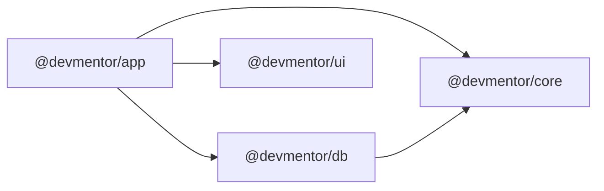

# DevMentor

Platforma ścieżek nauki dla programistów: uporządkowane ścieżki (moduły → lekcje → zadania praktyczne), śledzenie postępów i panel administracyjny.

## Stos technologiczny

| Obszar                      | Technologia                                                     |
| --------------------------- | --------------------------------------------------------------- |
| Aplikacja                   | Next.js 16 (App Router, Cache Components), React 19, TypeScript |
| Baza danych                 | PostgreSQL 17 + MikroORM 7 (migracje, seedy, pula połączeń)     |
| Dependency Injection        | Awilix                                                          |
| Frontend (strony publiczne) | Tailwind CSS 4                                                  |
| Backend (panel `/admin`)    | shadcn/ui (Base UI) na tych samych tokenach Tailwind            |
| Monorepo                    | npm workspaces                                                  |

## Architektura

```
packages/
├── app/   @devmentor/app   aplikacja Next.js — strony, routing, composition root DI
├── core/  @devmentor/core  domena: typy, porty (interfejsy repozytoriów), serwisy
├── db/    @devmentor/db    MikroORM: encje, konfiguracja, migracje, seedy, repozytoria
└── ui/    @devmentor/ui    shadcn/ui, `cn`, globalny arkusz Tailwind z tokenami motywu
```

### Zależności między pakietami



- **`core`** jest niezależny od frameworka i ORM-a. Definiuje model domenowy (`LearningPath`, `Lesson`, `UserProgress`, …), **porty** (`LearningPathRepository`, `ProgressRepository`, `StatsRepository`) oraz serwisy (`LearningPathService`, `ProgressService`, `AdminService`), które zależą wyłącznie od portów.
- **`db`** dostarcza adaptery: repozytoria MikroORM implementujące porty z `core` i mapujące encje na typy domenowe. Tu są też encje (`defineEntity`, bez dekoratorów), migracje i seedy.
- **`ui`** zawiera komponenty shadcn/ui i wspólne tokeny motywu (konwencja shadcn: `--background`, `--primary`, `--muted-foreground`, …). Ciemny motyw przez `prefers-color-scheme`.
- **`app`** spina wszystko w jednym miejscu (composition root) i renderuje strony.

Pakiety wewnętrzne eksportują źródła TypeScript (pole `exports`) — nie mają kroku build; kompiluje je Next.js (`transpilePackages`).

### Dependency Injection (Awilix)

`packages/app/lib/container.ts` tworzy kontener i wywołuje funkcje rejestracji z pakietów:

| Rejestracja                                                       | Czas życia                                | Źródło         |
| ----------------------------------------------------------------- | ----------------------------------------- | -------------- |
| `config`                                                          | singleton                                 | `app`          |
| `orm` (instancja MikroORM = pula połączeń)                        | singleton (jedna na proces, przetrwa HMR) | `registerDb`   |
| `em` (`orm.em.fork()`)                                            | scope żądania                             | `registerDb`   |
| `learningPathRepository`, `progressRepository`, `statsRepository` | scope żądania                             | `registerDb`   |
| `learningPathService`, `progressService`, `adminService`          | scope żądania                             | `registerCore` |

Scope żądania tworzy `getRequestContainer()` — raz na render dzięki `React.cache`, więc każde żądanie ma własną mapę tożsamości MikroORM. Komponenty serwerowe pobierają serwisy przez `resolve("learningPathService")`.

### Przepływ danych

```
Strona (Server Component, w <Suspense>)
  → resolve("learningPathService")        # Awilix, scope żądania
    → LearningPathService (core)          # logika domenowa
      → LearningPathRepository (port)     # interfejs w core
        → MikroLearningPathRepository (db) → EntityManager (fork) → PostgreSQL
```

Przy włączonym `cacheComponents` dostęp do bazy jest danymi czasu żądania (`getRequestContainer` wywołuje `connection()`): strony mają prerenderowany statyczny shell, a dane dochodzą strumieniowo. Dzięki temu `next build` nie potrzebuje bazy.

### Frontend vs. backend

| Część                 | Ścieżka                                                                                             | UI                                                 |
| --------------------- | --------------------------------------------------------------------------------------------------- | -------------------------------------------------- |
| Strony publiczne      | `packages/app/app/(site)/` — `/`, `/paths`, `/paths/[slug]`, `/paths/[slug]/[lesson]`, `/dashboard` | Tailwind + komponenty z `packages/app/components/` |
| Panel administracyjny | `packages/app/app/admin/` — `/admin`, `/admin/paths`                                                | shadcn/ui z `@devmentor/ui`                        |

### Model danych

`learning_path` 1─n `path_module` 1─n `lesson`; `app_user` n─n `learning_path` przez `enrollment`; `app_user` n─n `lesson` przez `lesson_completion`.

## Uruchomienie lokalne

Wymagania: Node.js 24 LTS (`.nvmrc`), npm 11, Docker. `npm install` instaluje też hooki git (lefthook).

```bash
npm install
cp .env.example .env          # jeden .env w roocie; w dev domyślne wartości pasują do docker compose
npm run db:up                 # PostgreSQL w Dockerze
npm run db:migrate            # migracje
npm run db:seed               # przykładowe ścieżki i konto demo
npm run dev                   # http://localhost:3000
```

Do czasu wdrożenia uwierzytelniania „zalogowanym” użytkownikiem jest konto demo z seeda (`DEMO_USER_EMAIL`).

## Skrypty

| Skrypt                            | Opis                                                                                                      |
| --------------------------------- | --------------------------------------------------------------------------------------------------------- |
| `npm run dev` / `build` / `start` | Aplikacja Next.js (`@devmentor/app`)                                                                      |
| `npm run check`                   | Wszystkie statyczne sprawdzenia: `format:check`, `lint`, `typecheck`, `knip`                              |
| `npm run typecheck`               | `tsc` we wszystkich pakietach                                                                             |
| `npm run lint`                    | ESLint we wszystkich pakietach: coding standards (type-aware) i kierunek zależności (`eslint.shared.mjs`) |
| `npm run format` / `format:check` | Prettier (z sortowaniem klas Tailwind)                                                                    |
| `npm run knip`                    | Nieużywane pliki, eksporty i zależności                                                                   |
| `npm test`                        | Testy jednostkowe (Vitest)                                                                                |
| `npm run test:coverage`           | Testy `core` z progiem pokrycia 90%                                                                       |
| `npm run test:integration`        | Testy repozytoriów na prawdziwym Postgresie (Testcontainers — wymaga Dockera)                             |
| `npm run test:e2e`                | Playwright + axe na buildzie produkcyjnym (wymaga zmigrowanej i zaseedowanej bazy)                        |
| `npm run audit`                   | Audyt zależności produkcyjnych (`audit-ci.jsonc`)                                                         |
| `npm run db:up`                   | Start PostgreSQL (docker compose)                                                                         |
| `npm run db:migrate`              | Zastosuj migracje                                                                                         |
| `npm run db:migration:create`     | Wygeneruj migrację z różnicy encji i snapshotu                                                            |
| `npm run db:seed`                 | Uruchom `DatabaseSeeder` (idempotentny)                                                                   |

Dodawanie komponentu shadcn/ui: `cd packages/app && npx shadcn@latest add <komponent>` — trafi do `packages/ui/src/components/`.

## CI i zależności

- **GitHub Actions** (`.github/workflows/ci.yml`): job `checks` (format, lint, typecheck, testy unit + pokrycie, integracja na Testcontainers, build, knip, audit) i job `e2e` (Postgres jako service, migracje, seed, Playwright + axe). Akcje przypięte do SHA.
- **Turborepo** (`turbo.json`) orkiestruje zadania pakietów i cache'uje wyniki (`lint`, `typecheck`, `test*`, `build`).
- **Polityka wersji**: `.npmrc` instaluje tylko wersje starsze niż 14 dni (poza Next.js); **Renovate** (`renovate.json`) aktualizuje z tym samym opóźnieniem.

## Dla agentów AI

Zasady pracy (architektura, SDD, logi, lekcje) są w [AGENTS.md](AGENTS.md). Specyfikacje: `.ai/specs/`.
